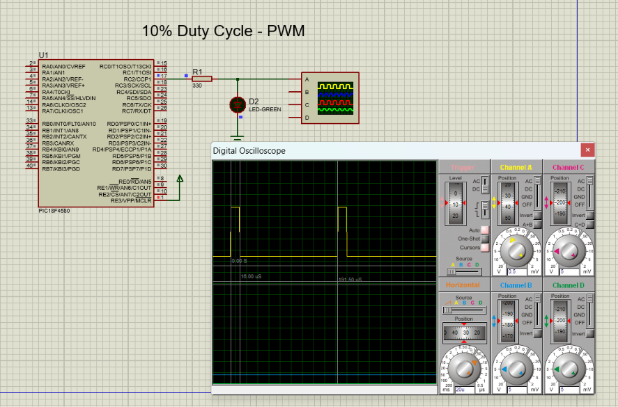
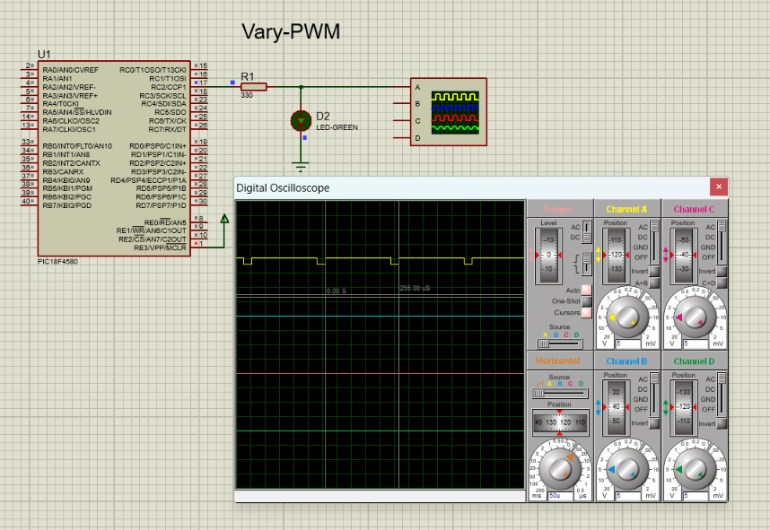

# PIC18F4580 PWM

This repository contains PWM generation projects using the PIC18F4580
microcontroller, CCP1 module, and Timer2.

Two implementations are included:

- Fixed PWM duty cycle
- Variable PWM duty cycle

The PWM output is generated on RC2/CCP1 and verified using Proteus
simulation and a digital oscilloscope.

## Tools & Technologies

- Microcontroller: PIC18F4580
- Programming Language: Embedded C
- Compiler: MPLAB C18
- Simulation: Proteus
- PWM Module: CCP1
- Timer: Timer2
- PWM Output: RC2/CCP1

## Project Structure

```text
PIC18F4580-PWM/
│
├── Fixed_PWM/
│   ├── fixed_pwm.c
│   └── fixed_pwm.png
│
├── Variable_PWM/
│   ├── variable_pwm.c
│   └── variable_pwm.png
│
└── README.md
```

## 1. Fixed PWM

The first project configures CCP1 in PWM mode and generates a fixed
duty-cycle PWM signal on RC2/CCP1.

### Proteus Simulation



## 2. Variable PWM

The second project varies the PWM duty-cycle value continuously by
increasing and then decreasing it.

### Proteus Simulation



## PWM Signal Flow

```text
Timer2
   ↓
PWM Time Base
   ↓
CCP1 PWM Module
   ↓
RC2 / CCP1
   ├──→ LED
   └──→ Oscilloscope
```

## Project Comparison

| Feature | Fixed PWM | Variable PWM |
|---|---|---|
| CCP Module | CCP1 | CCP1 |
| PWM Pin | RC2 | RC2 |
| Timer | Timer2 | Timer2 |
| Duty Cycle | Fixed | Variable |
| Simulation | Proteus | Proteus |

## Learning Objectives

- Understand PWM generation using PIC18F4580
- Configure CCP1 in PWM mode
- Configure Timer2
- Generate fixed-duty PWM
- Generate variable-duty PWM
- Observe PWM waveforms using an oscilloscope
- Understand PWM duty-cycle control

## Author

Raju Malekar

Electronics Engineer | Embedded Systems Enthusiast

Areas of interest:
- Embedded C
- PIC Microcontrollers
- PWM
- Timers
- ADC
- LCD Interfacing
- Embedded Systems
- Proteus Simulation
